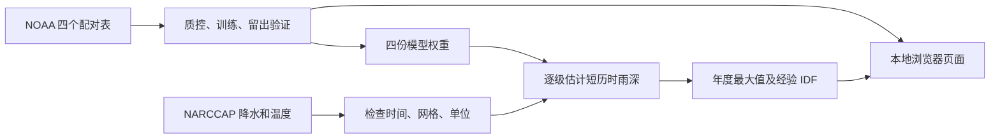

# CEE 598 降水时间降尺度交接手册

_供新电脑和没有原对话记录的协作者使用。命令从本仓库根目录运行。_

---

## 🚦 当前状态与新电脑的任务

截至基线提交 [`9d32948`](https://github.com/Lucky00130603/CEE-598-Porject/commit/9d32948cf43c949b12f98a58e39bf9b6e94b82fb)，`handoff/cee598` 已有四个 NOAA 随机拆分模型、ECP2 历史期 1971–2000 和未来期 2041–2070 的 260 格点预测、年最大值、经验 IDF 和诊断图表。逐窗口 NetCDF 已通过 Git LFS 哈希校验，可精确重算年最大值；IDF 表也已从年最大值精确复算。现有结果在 [results/final-ecp2](results/final-ecp2)，气候运行细节见 [ECP2_RUN.md](ECP2_RUN.md)。

| 顺序 | 剩余任务 | 用到的数据 |
|---|---|---|
| **1** | 四个 NOAA 任务按站点留出训练与测试 | 仓库的四张 NOAA 配对表，现已齐备 |
| **2** | 在同一批样本和留出站点上比较四输入基线与十输入空间 MLP | NOAA 站点 ID、经纬度、高程，以及同一时刻有五个固定近邻的粗时段降水 |
| **3** | 独立复核 ECP2 未来期温度坐标对齐并记录证据 | Oscar 的原始未来期 `pr`、`tasmax`、`tasmin` NetCDF；如可取得，再与工作副本对照 |

保留 `results/final-ecp2` 和 `results/pilot-ecp2` 作为已完成的结果。剩余任务使用独立输出目录。其他气候模式仅在最终范围要求多模式比较时安排；基线和 NOAA 空间实验均可单独交付。

## 📋 项目目标和完成标准

用伊利诺伊州 NOAA 站点观测训练四个独立 MLP，依次学习 `3 h → 2 h → 1 h → 30 min → 15 min`，再将四个模型串联应用到 NARCCAP 历史和未来期网格。每个 MLP 保留四个输入：上一级雨深、日雨深、日最高温、日最低温。模型是 4 输入、10 个 sigmoid 隐层单元、1 个线性输出。项目指导教师要求交代数据是否已取得、预处理过程、有效样本数、特征及回归标签统计，并用实际训练、初步结果、失败和原因说明进度。教师也要求说明 MLP 如何接收空间关系，见下方空间实验。

完成基线的证据包括四套站点测试指标、历史及未来网格预测、年度最大值和本地展示页面。空间模型的证据包括数据覆盖表、有无空间特征的同样本对照和站点留出结果。极端降水分析要注明年份范围、有效年数及降尺度输出的含义。



## 📦 数据放在哪里

| 数据 | 在新电脑的位置 | 来源与状态 |
|---|---|---|
| **NOAA 四套配对表** | `data/noaa data.zip` | 随 Git 克隆。首次训练自动提取到 `data/processed/noaa_pairs/` |
| **NARCCAP NetCDF** | `data/raw/narccap/` | 从 Oscar 的 SharePoint 下载原名 `*_checked.nc`。保留原名，子目录也可 |
| **空间站点元数据** | `data/raw/noaa_stations.csv` | 向 NOAA 数据负责人取得。需要真实 `STATION,latitude,longitude,elevation`，站点 ID 和配对表一致 |
| **原始站点连续记录** | `data/raw/noaa/` | 如要核验连续时序或重建训练配对，取得原始小时和 15 分钟观测、日汇总和质量标记 |
| **已训练权重** | `results/<run>/training/<task>/model.pt` | 可在新电脑重新生成。也可私下复制四个原始任务目录并用 `--weights` 指向其父目录 |

NOAA 配对表列为 `STATION,timestamp,P_in,P_target,P_d,Tmax_d,Tmin_d`。雨深按英寸、温度按华氏度使用。原始四表共 1,630,093 行，原质控后 1,594,662 行。Report II 的行数、零值比例、均值、99 分位和最大值见 [已有结果](results/report2/dataset_summary.csv)。既有 (R^2) 是随机记录拆分的结果，应用到新站点或未来年份前须另行评估。

SharePoint 的目录核对显示 24 个 NetCDF，四个模式 × 两个时期 × 三个变量。三小时 `pr`、日 `tasmax`、日 `tasmin` 分开保存。先下载 ECP2–HadCM3 的六个文件即可试跑历史和未来，随后再处理其它模式。实际日期和网格由运行时检查。[^1]

| CLI 模型 | 文件名内模型 | 历史文件标称年份 | 未来文件标称年份 |
|---|---|---|---|
| **`ecp2`** | `ECP2_hadcm3` | 1968–2000 | 2038–2070 |
| **`hrm3`** | `HRM3_gfdl` | 1968–2000 | 2038–2070 |
| **`crcm`** | `CRCM_cgcm3` | 1968–2000 年 11 月 | 2038–2070 年 11 月 |
| **`mm5i`** | `MM5I_ccsm` | 1968–1998 | 2038–2069 |

默认项目窗口是 1971–2000 和 2041–2070。ECP2 和 HRM3 可优先尝试原窗口。四模式同窗比较可先检查 1971–1998、2041–2069 是否在四套实际文件中都完整，然后用相同窗口重新跑每个模型。各模式的原生网格保持独立。上传文件名中的年份只用于初步筛选。

## 💻 在新电脑准备环境

安装 Git 和 Python 3.11 或 3.12。当前 PyTorch MLP 使用 CPU。新机器先用 `--threads 4`，再按实测调整。运行前确认可访问 GitHub 以及 Oscar 的共享目录。项目数据和结果都用相对路径，仓库可以放在任意目录。

### macOS 或 Linux

```bash
git clone https://github.com/Lucky00130603/CEE-598-Porject.git
cd CEE-598-Porject
git switch handoff/cee598
python3 -m venv .venv
source .venv/bin/activate
python -m pip install -r requirements.txt
python -m pytest -q
mkdir -p data/raw/narccap
```

### Windows PowerShell

```powershell
git clone https://github.com/Lucky00130603/CEE-598-Porject.git
cd CEE-598-Porject
git switch handoff/cee598
py -3.12 -m venv .venv
.\.venv\Scripts\python.exe -m pip install -r requirements.txt
.\.venv\Scripts\python.exe -m pytest -q
New-Item -ItemType Directory -Force data/raw/narccap
```

PowerShell 的可执行文件路径以 `.` 加反斜线开头，写作 `.\.venv\Scripts\python.exe`。下文所有 `python` 命令都可用这一完整写法替换。两个终端都在同一个仓库根目录。若已克隆仓库，先执行 `git fetch origin`，再切交接分支。

## 🧪 先完成 NOAA 站点留出验证

如果电脑上已有仓库，先切换交接分支并取得最新提交。全新环境执行上一节的克隆、安装和测试命令。已发布的两个 `window_depths.nc` 通过 Git LFS 保存。只做 NOAA 留出和空间实验时，保留 LFS 指针也能运行。需要查看气候逐窗口文件时用 Git LFS 拉取。

```bash
git switch handoff/cee598
git pull --ff-only origin handoff/cee598
python -m pytest -q
```

终端 A 启动 [本地进度页](http://127.0.0.1:8765/) 并保持可见。终端 B 从同一仓库根目录运行训练，首次会从仓库的 NOAA ZIP 提取配对表。

```bash
python -m src.dashboard --run-dir results/station-baseline
```

```bash
python -m src.project train --split station --epochs 60 --threads 4 --run-dir results/station-baseline
```

验收时检查 `results/station-baseline/status.json` 为 `Complete`，`training/` 下四个任务均有 `data_summary.json`、`metrics.json`、`history.csv`、`predictions.csv` 和 `model.pt`。`data_summary.json` 的 `station_ids_by_split` 需满足训练、验证、测试站点集合两两不交。本机只试了当前四表的拆分，按上述历时顺序，测试站点数应为 16、16、15、15。保存每个任务的实际留出站点数、测试样本数、MAE、RMSE 和 R²，再对照旧随机拆分结果说明两种评估各自代表什么。随机拆分和站点拆分用了不同测试样本，指标差异用来描述泛化难度。

## 🔁 已完成基线的复现参考

以下四步仅在需要复现已发布 ECP2 基线时执行。真实 ECP2 文件的已验证用法和未来期坐标处理记录见 [ECP2_RUN.md](ECP2_RUN.md)；实际使用 `--stamp end` 和经过核实的未来温度工作副本。

### 1. 打开浏览器页面

终端 A 保持运行。此命令会尝试打开默认浏览器。也可以在新电脑上手动访问 [本地页面](http://127.0.0.1:8765/)。页面自动刷新，显示当前阶段、epoch、训练及验证损失、NOAA 指标、结果图和文件链接。

```bash
python -m src.dashboard --run-dir results/reproduce-ecp2
```

若没有 GUI，可用 `--no-open` 并在运行机器的浏览器打开地址。换其他 run 名称时两个终端都要使用新名称。若端口占用，给页面命令加 `--port 8766`。运行目录和端口只在运行的电脑上有效。

### 2. 训练 NOAA 基线

终端 B 执行。四个任务顺序运行，默认使用 60 个 epoch 上限、patience 8、Adam 学习率 0.003、batch 4096，特征和标签均用训练集统计量标准化。首次直接读取仓库 ZIP。测试显示四个任务成功后，检查浏览器里的表格和图。先试装环境可改 `--epochs 1 --run-dir results/smoke`。

```bash
python -m src.project train --run-dir results/reproduce-ecp2 --threads 4
```

`--split station` 生成未见站点的评估。建议单独放在 `results/station-baseline` 以保留两种拆分。四个 MLP 均输出 `model.pt`、`metrics.json`、`history.csv`、`data_summary.json` 和 `predictions.csv`。四张预测 CSV 对应 NOAA 测试集。最终 NARCCAP 预测另存 NetCDF。

### 3. 先检查 NetCDF

按复现说明准备六个 ECP2 工作文件，放入 `data/raw/narccap/`。未来期温度工作副本应已经过坐标复核。下面两条命令列出时间轴、单位和覆盖，并验证变量网格是否对齐。

```bash
python -m src.climate --model ecp2 --period historical --stamp end
python -m src.climate --model ecp2 --period future --stamp end
```

如果 `pr` 有净长三小时的 time bounds，程序使用左端点。若报 `pr has no time bounds`，根据源文件或 Oscar 的处理记录确认时间戳代表区间开始、中心还是结束，分别给检查和预测命令加 `--stamp start|center|end` 中的一个选项。仅看时刻间隔无法区分整三小时间隔的起点和终点。日最高、最低温按日期与降水匹配，`pr` 按已确认单位转三小时英寸，温度转华氏度。日雨深取同一日八个三小时累计值之和。程序会拒绝未知单位、未对齐网格、重复时间或指定年份内的时间缺口；有缺测的格点年份不会进入年最大值。

### 4. 执行 NARCCAP 预跑和正式运行

先用 ECP2 检查一个完整年份。示例采用已确认的 `--stamp end`，并将复现结果写到单独目录。

```bash
python -m src.project predict --model ecp2 --period historical --historical-years 1971 1971 --stamp end --weights results/reproduce-ecp2/training --run-dir results/reproduce-pilot-ecp2
python -m src.project predict --model ecp2 --period both --stamp end --run-dir results/reproduce-ecp2 --save-windows
```

预跑页面用 `python -m src.dashboard --run-dir results/reproduce-pilot-ecp2 --port 8766`。正式命令从同名 `run-dir` 的 `training/` 自动找权重。立刻使用旧权重时，用 `--weights /path/to/the/four/task-folders`。也可用 `python -m src.project all --model ecp2 --stamp end --run-dir results/reproduce-ecp2` 从头做训练及推理。每次运行的进度存 `status.json`。同时跑不同项目时使用独立的输出目录。四模型用同一时间窗口时，在各自目录执行并加入 `--historical-years 1971 1998 --future-years 2041 2069`，以实际检查结果为准。

## 📊 结果和老师要看的证据

| 产物 | 路径（相对 run-dir） | 用途 |
|---|---|---|
| **数据和模型诊断** | `evaluation/*.csv`、`evaluation/*.png` | 样本数、标签统计、基线、损失曲线、负预测和大雨表现 |
| **气候预测** | `<model>/<period>/window_depths.nc` | 加 `--save-windows` 后输出，每个三小时窗口对应五个历时 |
| **年最大值** | `<model>/<period>/annual_maxima.nc` | 按格点、年份和历时保存，并附有效窗口比例 |
| **经验 IDF** | `empirical_idf.csv`、`empirical_idf.png`、`idf_grid_cells.csv` | 默认采用最靠近 Urbana 的格点，可用 `--site LAT LON` 改位置 |
| **页面和日志** | `index.html`、`status.json` | 显示进度、结果图和数据链接 |

串联推理对每个三小时窗口输出一组嵌套历时雨深，同时保留原始三小时量。干窗输出零，湿窗约束在 0 和上一级雨深之间。一个三小时窗口只产生一个 15 分钟历时雨深估计，窗口内实际 15 分钟时序仍需另外建模和验证。年度最大值是各窗口估计的最大值。经验 IDF 依降序名次 (m) 和有效年数 (n) 计算 (T=(n+1)/m)，并把雨深除以历时小时数。用已有年份的经验重现期解释这张图。超出样本范围的设计重现期需要另做分布拟合、不确定性和观测验证。

报告中至少列出各模型的 station count、原始和有效样本量、回归特征及目标统计、基线和验证类型。有代表性的已知限制包括 3 h → 2 h 的 ANN 与时长缩放基线接近，少量幅度很小的负输出，以及 30 min → 15 min 在大雨尾部的指标下降。四张 NOAA 配对表中所有零目标行的 `P_in` 也为零。若要验证完整降水过程，回访 NOAA 原始记录，区分缺测、干窗和粗窗为湿但局部短窗为干。NARCCAP 历法修补可能改变降水极端值。正式比较前应向 Oscar 取得缺测/插补审计，记录哪些年份及格点受影响。[^1]

## 🗺️ 空间实验

### 数据准备和覆盖检查

先从组内 NOAA 原始下载或官方站点目录取得站点元数据，保留数据来源和高程单位。制成 UTF-8 的 `data/raw/noaa_stations.csv`，表头为 `STATION,latitude,longitude,elevation`。`STATION` 按字符串保存，需要与配对表精确对应，包括 `COOP:` 等前缀及前导零。每个 ID 一行，经纬度为十进制度，高程统一为米。缺坐标或高程的站点列出并向数据负责人补查。

本机对四张现有配对表做过覆盖上界检查。达到同一时间至少六个站点的记录上限分别为 `3h_to_2h` 116,332 行、`2h_to_1h` 193,305 行、`1h_to_30min` 62,107 行、`30min_to_15min` 178,599 行。上界允许任意五个邻站且尚未质控，真正能匹配五个**固定最近邻**的行数会更少。须跑空间匹配后再判断数据是否充足。

按原计划，经纬度、高程和五个固定最近邻同一时刻的粗时段雨深 `P_in` 的反距离加权均值、最大值、标准差合计六个额外输入。用脚本输出的原始行数与匹配行数计算覆盖率。若任何任务提示站点不足或测试站点覆盖太薄，先记录受影响任务、保留率和站点分布，再向 NOAA 数据负责人取得同时间段的原始小时或 15 分钟记录用于构造邻站粗时段雨深。对齐时间约定并区分缺测和真实零值。保留任意更少邻站的试验时，另标为敏感性分析并说明改动。

### 匹配样本上的公平对照

```bash
python -m src.spatial --pairs data/processed/noaa_pairs --stations data/raw/noaa_stations.csv --out data/processed/noaa_spatial
python scripts/train_all.py --data-dir data/processed/noaa_spatial --split station --epochs 60 --patience 8 --batch-size 4096 --learning-rate 0.003 --output-root results/spatial-matched-baseline
python scripts/train_all.py --data-dir data/processed/noaa_spatial --spatial --split station --epochs 60 --patience 8 --batch-size 4096 --learning-rate 0.003 --output-root results/spatial-mlp
```

两次训练用同一张增强表和默认 seed 42。确认两套 `data_summary.json` 的 `station_ids_by_split` 相同，再核对各任务 `predictions.csv` 的 `STATION,timestamp,observed` 一致。用下列命令分别生成便于展示的图和表。

```bash
python scripts/summarize_report2.py --input-root results/spatial-matched-baseline --output results/spatial-matched-baseline/evaluation
python scripts/summarize_report2.py --input-root results/spatial-mlp --output results/spatial-mlp/evaluation
```

交付四任务对照表，列匹配保留率、测试站点数、测试样本数，以及四输入与十输入的 MAE、RMSE、R²。报告有空间特征之后误差是否下降及哪些历时没有改善；保留 `threshold_metrics.csv` 用于强降水比较。空间训练命令在终端显示任务进度，产出后可直接打开两套 `evaluation/` 下的 PNG。邻站只使用推理时可获得的粗时段输入。这是在邻站观测可用条件下对新目标站的评估；如最终范围要求整个未知区域泛化，则要额外按空间分区屏蔽不可用邻站。当前气候推理仍使用已验证的四输入权重。

## 🔍 复核 ECP2 未来期输入

从 Oscar 的目录取回同一模型和时期的三个未改动文件，同时保留原件。按 [ECP2_RUN.md](ECP2_RUN.md) 逐项查验。

1. 用 `ncdump -h` 或 Python `netCDF4` 记录三文件的变量维度、原生 x/y 轴、投影属性、时间轴和单位。在复制经纬度前，先核对三个文件的原生 x/y 数值和顺序、投影参数，以及温度维度与 `pr` 网格一致。独立反投影 x/y，与降水的 `lat_wgs84`、`lon_wgs84` 对照并记录误差。若网格参数有实质差异，保留原件，报告问题并先确定重网格方案。
2. 用单独工作目录保存温度副本。确认是附带经纬度错误后，只在副本上修复两个地理坐标数组。校验修改前后温度值、缺测掩膜和时间轴不变。记录原始文件名、修正方法和验证结果，然后执行 `python -m src.climate --model ecp2 --period future --stamp end --climate-dir <工作副本目录>`。尖括号位置替换为实际路径。
3. 需要抽样复核推理时，使用已发布的四个 ECP2 基线权重，把未来期 2041 单年跑入独立目录。将该年最大值按格点和历时与已发布的 2041 年比较并报告最大绝对差。如果确有数据差异，查清原因后再决定是否重跑正式时段。

```bash
python -m src.project predict --model ecp2 --period future --future-years 2041 2041 --stamp end --weights results/final-ecp2/training --run-dir results/coord-qa-ecp2 --climate-dir data/raw/ecp2-verified
```

`data/raw/ecp2-verified` 仅是上例的工作副本目录。不得以已完成的输出互相吻合作为原始网格对齐的证据。

## 🔧 无上下文交接和故障检查

| 现象 | 检查 |
|---|---|
| **找不到配对表** | 从仓库根目录运行，并确认 Git 已克隆 `data/noaa data.zip` |
| **缺失或重复 NetCDF** | 下载每个模型各期的三变量原名文件，避免同一文件在两个子目录重复 |
| **指定年份缺失** | 核对日志的第一个缺失时间和数据处理记录，选择完整年份。不得补零来通过检查 |
| **模型推理找不到权重** | 先训练，或把 `--weights` 指定为含四个任务子目录的父目录 |
| **网页一直等待** | 两终端使用同一个 `--run-dir`，打开 127.0.0.1 的地址并让页面服务保持运行 |
| **空间样本不足** | 记录五邻站匹配后保留率，回查 NOAA 站点覆盖和时间对齐 |

原始 Report II 四组训练在 Apple M5 MacBook Air（24 GB）的本地 checkout 执行，仓库根目录为 `CEE492-Codex/cee598_report2_work/repo`，项目通过相对路径在任何机器上运行。交接分支增加了可见的本地 Dashboard、NetCDF 预测和空间实验入口。在新电脑上请打开运行页面展示实际过程，保存最终 `results/<run>/`，把模式、年份、时间戳约定、测试结果及运行路径写入最终汇报。

原交接在 Mac 上做了真实 NOAA 单 epoch 和合成 NetCDF 测试。后续另一台电脑已完成真实 ECP2 基线，运行记录见 [ECP2_RUN.md](ECP2_RUN.md)。新一轮交接的完成条件是站点留出四任务结果、空间对照或有量化依据的数据缺口说明，以及 ECP2 输入坐标复核记录。

可以把下面这段直接交给另一台电脑的 Codex。

> 这是 CEE 598 Illinois 降水时间降尺度项目。切到 GitHub `handoff/cee598` 的最新提交，读 `PROJECT_HANDOFF.md` 的当前状态和剩余任务。先启动 `results/station-baseline` 的 Dashboard，把四个 NOAA 站点留出任务跑完。检查训练、验证和测试站点互斥，保留日最高、最低温。查找 NOAA 真实站点元数据，先检查五邻站同期覆盖，再在相同样本和留出站点上运行四输入和十输入对照。按说明复核 ECP2 未来期输入网格，已有历史和未来基线结果先保留。展示页面、图表、输出路径和数据缺口。

[^1]: Oscar 的 [NARCCAP 数据说明](data/NARCCAP/README.md)。请使用团队现有的 SharePoint 访问权限。如果新电脑无法读取目录，请向 Oscar 索取共享入口。
